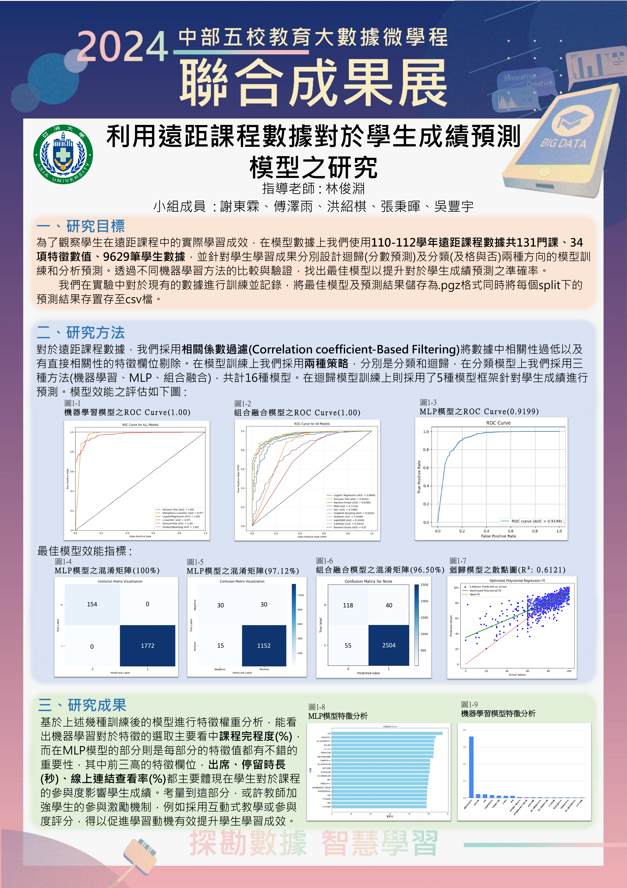

<a id="zh-tw"></a>

# 遠距課程學生成績預測與學習行為分析

**2024 中部五校教育大數據微學程聯合成果展－銀獎**

[繁體中文](#zh-tw) | [English](#english)

這是我的教育大數據研究個人作品集，整合我參與的 MLP、邏輯迴歸、成績迴歸、CFT 組合融合及 XGBoost＋SHAP。透過遠距課程的學習行為紀錄，預測課程成績與學生是否及格，並分析特徵對模型預測的貢獻。

## 研究資料

研究使用 110–112 學年的遠距課程學習紀錄，成果展海報記載 131 門課程、9,629 筆紀錄。資料涵蓋平台造訪、停留時間、影音觀看、作業與測驗繳交、討論互動及出缺席等學習行為。

公開儲存庫不包含學生原始資料。執行 `experiments/` 中的流程時，請自行準備已獲授權的 CSV，使用 `課程成績` 作為迴歸目標，或以 `及格與否`（0＝不及格、1＝及格）作為分類目標。分類資料需同時包含兩種類別，其餘可用數值欄位作為特徵。

## 程式與檔案

| 檔案 | 功能 |
| --- | --- |
| [experiments/mlp.py](experiments/mlp.py) | PyTorch MLP 及格分類、驗證集提前停止、分類門檻選取與置換特徵重要性 |
| [logistic_regression.py](logistic_regression.py) | PyTorch 邏輯迴歸及格分類、SMOTEENN、評估指標與特徵權重圖；於 Google Colab 執行 |
| [experiments/regression.py](experiments/regression.py) | 隨機森林、梯度提升、AdaBoost、XGBoost、LightGBM、CatBoost、Ridge、Lasso 與 SVR 的成績迴歸及參數搜尋 |
| [experiments/ensemble.py](experiments/ensemble.py) | CFT 組合融合：9 種分類器的軟投票、交叉驗證與參數搜尋 |
| [experiments/shap_analysis.py](experiments/shap_analysis.py) | XGBoost 及格分類與 SHAP 特徵貢獻分析 |
| [experiments/common.py](experiments/common.py) | 共用資料讀取、欄位篩選、評估指標與結果輸出 |
| [tests/](tests/) | 資料欄位排除、迴歸流程、MLP 門檻選取與訓練輸出的 4 項自動化測試 |
| [requirements.txt](requirements.txt) | `experiments/` 流程的 Python 套件需求 |
| [docs/](docs/) | 成果展海報圖片與 PDF |

## 安裝與資料準備

建議使用 Python 3.10–3.12，在專案根目錄建立並啟用虛擬環境。

Windows PowerShell：

```powershell
python -m venv .venv
.\.venv\Scripts\Activate.ps1
python -m pip install -r requirements.txt
```

macOS / Linux：

```bash
python -m venv .venv
source .venv/bin/activate
python -m pip install -r requirements.txt
```

自行建立 `data/`，將已獲授權的資料放在 `data/test.csv`。資料與執行結果已由 `.gitignore` 排除，不會加入版本控制。

## 執行方式與輸出

在專案根目錄執行：

```bash
python -m experiments.mlp --data data/test.csv --output results/mlp
python -m experiments.regression --data data/test.csv --output results/regression
python -m experiments.ensemble --data data/test.csv --output results/ensemble
python -m experiments.shap_analysis --data data/test.csv --output results/shap
```

縮短訓練或搜尋的試跑設定：

```bash
python -m experiments.mlp --data data/test.csv --epochs 20 --patience 5 --importance-repeats 0
python -m experiments.regression --data data/test.csv --models ridge random_forest --cv 3 --n-iter 3
python -m experiments.ensemble --data data/test.csv --cv 3 --n-iter 3
python -m experiments.shap_analysis --data data/test.csv --max-samples 100
```

自動化測試使用合成資料，不需要學生資料：

```bash
python -m unittest discover -s tests -v
```

MLP 輸出模型權重、前處理器、訓練紀錄、含混淆矩陣的評估指標、ROC 曲線與置換特徵重要性；迴歸與融合流程輸出最佳模型及測試指標，迴歸另輸出交叉驗證比較表；SHAP 輸出測試指標、特徵重要性表格、摘要圖、瀑布圖與依賴圖。各流程預設儲存於 `results/` 的對應子目錄；`--importance-repeats 0` 會略過 MLP 特徵重要性輸出。

### 邏輯迴歸（Google Colab）

將 [logistic_regression.py](logistic_regression.py) 上傳至 Colab 的檔案區，在筆記本執行下列指令，再透過程式顯示的上傳介面選擇 CSV：

```python
%pip install imbalanced-learn
!apt-get -qq install -y fonts-wqy-zenhei
%run logistic_regression.py
```

此腳本依固定順序重新指定 32 個欄位名稱，CSV 的欄位數與順序需符合腳本中的 `data.columns` 清單。評估指標與特徵權重圖直接顯示於 Colab。

## 實驗評估

- `experiments/` 各流程的缺失值填補、標準化（適用時）與參數搜尋使用訓練資料；測試集保留至最終評估。
- 及格分類排除 `課程成績`、`分數等級`；成績迴歸排除 `及格與否`、`分數等級`，兩者皆排除 `cou_code`。
- MLP 使用 100→50 隱藏層、BatchNorm、Dropout、訓練集類別加權及獨立驗證集。提前停止依據驗證損失，分類門檻依驗證集 Macro-F1 選取。
- 成績迴歸以交叉驗證 R² 選擇模型，報告測試集 R²、MAE、MSE、RMSE 與 MAPE；CFT 以交叉驗證 Macro-F1 搜尋參數。`experiments/` 的分類流程報告 Macro-F1、Balanced Accuracy、各類召回率及 ROC-AUC 等指標。
- 邏輯迴歸腳本包含資料切分前補值，且使用測試資料選取分類門檻，其指標應視為探索性結果。
- 置換特徵重要性與 SHAP 說明模型如何使用特徵，不代表因果影響。

研究資料缺少可核對的學生唯一識別碼與統一預測時間點，因此採用紀錄層級隨機切分。評估結果不能直接代表跨學生、跨學期或課程早期預警的泛化能力。

## 成果展海報

2024 中部五校教育大數據微學程聯合成果展-銀獎。海報呈現研究目標、方法與展示結果。

[開啟高解析度圖片](docs/asia-university-research-poster.png) · [下載 PDF](docs/asia-university-research-poster.pdf)

[](docs/asia-university-research-poster.png)

---

<a id="english"></a>

# Student Grade Prediction and Learning Behavior Analysis in Remote Courses

**Silver Award — 2024 Joint Exhibition of the Educational Big Data Microprogram across Five Universities in Central Taiwan**

[繁體中文](#zh-tw) | [English](#english)

This is my personal portfolio of educational data research, bringing together the MLP, logistic regression, grade regression, CFT ensemble, and XGBoost + SHAP work I participated in. The project uses learning behavior records from remote courses to predict course grades and pass/fail outcomes, and to analyze how features contribute to model predictions.

## Research Data

The research uses remote-course learning records from academic years 110–112 in Taiwan's ROC calendar. The exhibition poster reports 131 courses and 9,629 records. Features cover platform visits, time spent, video viewing, assignment and quiz submissions, discussion activity, and attendance.

This public repository does not include raw student data. To run the workflows in `experiments/`, supply an authorized CSV with `課程成績` (course grade) as the regression target or `及格與否` (0 = fail, 1 = pass) as the classification target. Classification data must contain both classes; other usable numeric columns serve as features.

## Code and Files

| File | Purpose |
| --- | --- |
| [experiments/mlp.py](experiments/mlp.py) | PyTorch MLP pass/fail classification, validation-based early stopping, threshold selection, and permutation feature importance |
| [logistic_regression.py](logistic_regression.py) | PyTorch logistic regression for pass/fail classification, SMOTEENN, evaluation metrics, and feature-weight plots; runs in Google Colab |
| [experiments/regression.py](experiments/regression.py) | Grade regression and parameter search with Random Forest, Gradient Boosting, AdaBoost, XGBoost, LightGBM, CatBoost, Ridge, Lasso, and SVR |
| [experiments/ensemble.py](experiments/ensemble.py) | CFT ensemble: soft voting across nine classifiers, cross-validation, and parameter search |
| [experiments/shap_analysis.py](experiments/shap_analysis.py) | XGBoost pass/fail classification and SHAP feature attribution |
| [experiments/common.py](experiments/common.py) | Shared data loading, column filtering, evaluation metrics, and result export |
| [tests/](tests/) | Four automated tests covering excluded columns, the regression workflow, MLP threshold selection, and training outputs |
| [requirements.txt](requirements.txt) | Python dependencies for the `experiments/` workflows |
| [docs/](docs/) | Exhibition poster image and PDF |

## Installation and Data Preparation

Python 3.10–3.12 is recommended. Create and activate a virtual environment from the repository root.

Windows PowerShell:

```powershell
python -m venv .venv
.\.venv\Scripts\Activate.ps1
python -m pip install -r requirements.txt
```

macOS / Linux:

```bash
python -m venv .venv
source .venv/bin/activate
python -m pip install -r requirements.txt
```

Create `data/` and place your authorized dataset at `data/test.csv`. Data and generated results are excluded from version control by `.gitignore`.

## Running the Workflows and Outputs

Run from the repository root:

```bash
python -m experiments.mlp --data data/test.csv --output results/mlp
python -m experiments.regression --data data/test.csv --output results/regression
python -m experiments.ensemble --data data/test.csv --output results/ensemble
python -m experiments.shap_analysis --data data/test.csv --output results/shap
```

Trial settings with shorter training or smaller searches:

```bash
python -m experiments.mlp --data data/test.csv --epochs 20 --patience 5 --importance-repeats 0
python -m experiments.regression --data data/test.csv --models ridge random_forest --cv 3 --n-iter 3
python -m experiments.ensemble --data data/test.csv --cv 3 --n-iter 3
python -m experiments.shap_analysis --data data/test.csv --max-samples 100
```

The automated tests use synthetic data and do not require student records:

```bash
python -m unittest discover -s tests -v
```

The MLP exports model weights, preprocessing objects, training history, evaluation metrics including the confusion matrix, an ROC curve, and permutation feature importance. Regression and ensemble workflows export the selected model and test metrics; regression also exports a cross-validation comparison table. SHAP exports test metrics, a feature-importance table, and summary, waterfall, and dependence plots. Each workflow saves to its corresponding subdirectory under `results/` by default. Setting `--importance-repeats 0` skips the MLP feature-importance outputs.

### Logistic Regression (Google Colab)

Upload [logistic_regression.py](logistic_regression.py) to the Colab Files pane, run the following commands in the notebook, and then select your CSV using the upload prompt displayed by the script:

```python
%pip install imbalanced-learn
!apt-get -qq install -y fonts-wqy-zenhei
%run logistic_regression.py
```

The script assigns 32 column names in a fixed order. The CSV must match the number and order of columns in the script's `data.columns` list. Evaluation metrics and feature-weight plots are displayed directly in Colab.

## Experimental Evaluation

- The `experiments/` workflows fit missing-value imputation, scaling where applicable, and parameter searches on training data. The test set is reserved for final evaluation.
- Pass/fail classification excludes `課程成績` and `分數等級`; grade regression excludes `及格與否` and `分數等級`. Both exclude `cou_code`.
- The MLP uses 100→50 hidden units, BatchNorm, Dropout, training-set class weights, and a separate validation set. Early stopping uses validation loss; the classification threshold is selected by validation Macro-F1.
- Grade regression selects models by cross-validation R² and reports test R², MAE, MSE, RMSE, and MAPE. CFT searches parameters by cross-validation Macro-F1. Classification workflows in `experiments/` report Macro-F1, Balanced Accuracy, per-class recall, ROC-AUC, and related metrics.
- The logistic regression script imputes missing values before splitting the data and selects its classification threshold using test data. Its metrics should therefore be treated as exploratory results.
- Permutation importance and SHAP explain how a model uses features; they do not establish causal effects.

The research data lacks verifiable unique student identifiers and a consistent prediction cutoff, so evaluation uses random record-level splits. Results do not directly establish generalization to unseen students, future semesters, or early-course warning scenarios.

## Exhibition Poster

Silver Award at the 2024 joint exhibition of the Educational Big Data Microprogram across five universities in central Taiwan. The poster presents the research objectives, methods, and exhibition results.

[Open high-resolution image](docs/asia-university-research-poster.png) · [Download PDF](docs/asia-university-research-poster.pdf)

[](docs/asia-university-research-poster.png)
